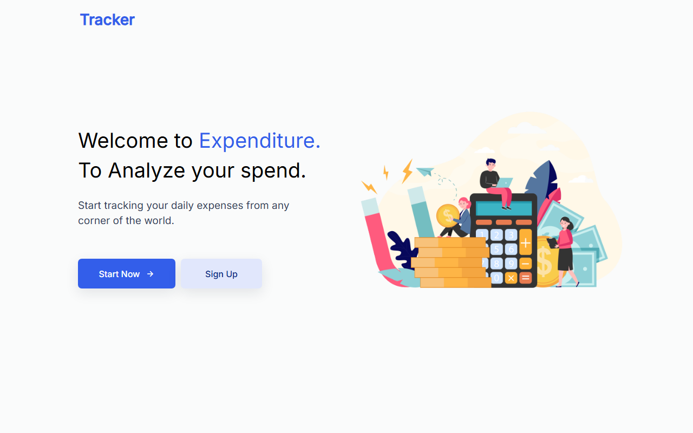
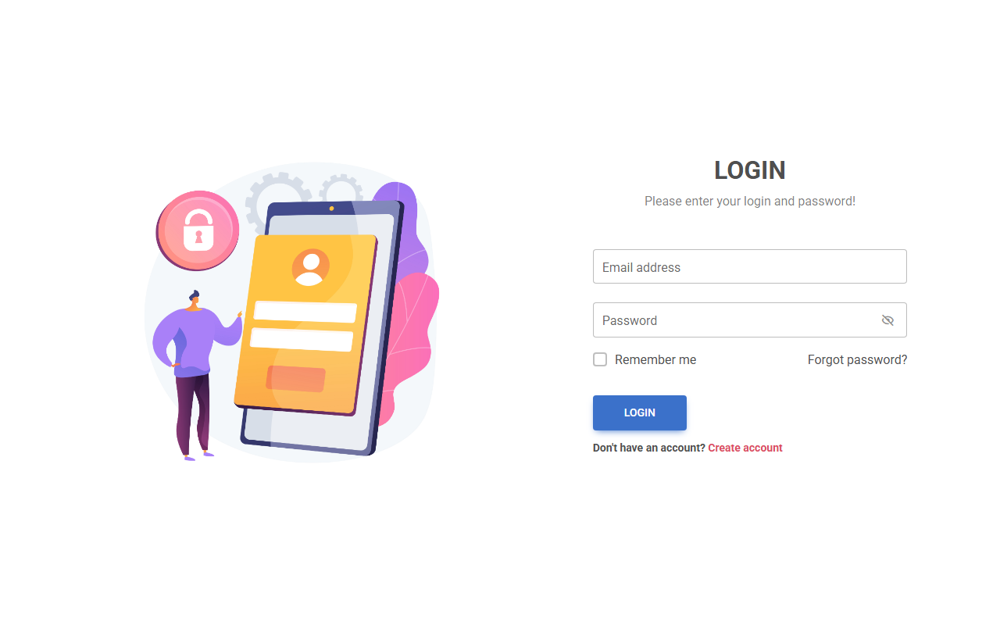
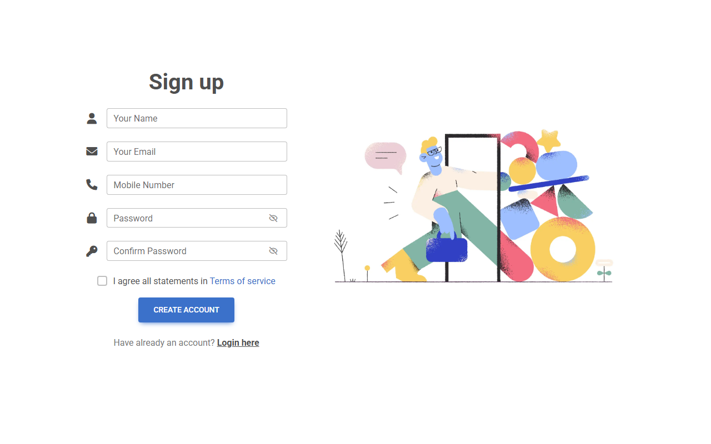

# Daily Expense Tracker


A web app for tracking daily expenses and income, built with PHP and MySQL. Each user has their own
account, categories, transactions, reports and charts.

| Landing page | Login | Sign up |
|---|---|---|
|  |  |  |

## Features

- **Accounts**: sign up and log in; passwords are stored as bcrypt hashes (`password_hash`)
- **Dashboard**: today's, yesterday's, last-30-days and total spending, plus a bar chart of the last 30 days
  that refreshes itself
- **Expenses and income**: add them with a date, category, amount and description; your own categories
  for each
- **Manage transactions**: one list of expenses and income with filters, pagination, edit and delete,
  and running totals
- **Reports**: expense, income or complete reports for any date range, ready to print
- **Analytics**: pie chart of spending by category
- **Profile**: update your name, email and phone, or change your password

## Run it locally (XAMPP)

1. Install [XAMPP](https://www.apachefriends.org/) and start **Apache** and **MySQL** in the XAMPP Control Panel.
2. Copy this folder into `C:\xampp\htdocs\` (for example `C:\xampp\htdocs\daily-expense-tracker`).
3. Open http://localhost/phpmyadmin, create a database named **`daily_expense`**, open it, choose
   **Import** and import `daily_expense.sql`.
4. Open http://localhost/daily-expense-tracker/ (use the folder name you chose in step 2).

If your MySQL user or password is not XAMPP's default (`root` with no password), change them in
`includes/database.php`.

### Demo logins

| Email | Password | Data |
|---|---|---|
| `demo@example.com` | `demo1234` | expenses and income |
| `test@example.com` | `demo1234` | a few expenses |

You can also create your own account with **Sign up**.

## Database

| Table | Contents |
|---|---|
| `users` | Name, email, phone, bcrypt password hash |
| `tblcategory` | Each user's expense and income categories |
| `tblexpense` | Expenses: date, category, amount, description |
| `tblincome` | Income: date, category, amount, description |

## Security

- Everything a user types (login, sign up, forms, profile, search) reaches the database only through
  prepared statements with `?` placeholders (`db_query()` in `includes/database.php`), so it cannot change
  the SQL.
- Report dates must be real `YYYY-MM-DD` dates (`valid_date()`), and URL filters only accept known values.
- Every query is limited to the logged-in user's own rows (`UserId = …`), including edits and deletes.

## Project structure

```
index.php                  landing page
daily_expense.sql          database schema with demo data
includes/
  database.php             database connection + db_query() and valid_date() helpers
  index.php, signup.php    login and sign up
  home.php, get_data.php   dashboard and its chart data
  add-expenses.php, add-income.php, add_category.php
  manage-transaction.php, update-expense.php, update-income.php
  report.php, expense-report.php, income-report.php, complete-report.php
  analytics.php, pie-data.php
  user_profile.php, update_user.php, logout.php
  css/, js/, images/       styles, scripts and images
docs/screenshots/          README images
```

## Team

Built by **Naman** ([@Naman-123123](https://github.com/Naman-123123)) and **Akshaj Chandak** as a web
technology project.

## Credits

- [Bootstrap](https://getbootstrap.com/), [jQuery](https://jquery.com/), [Chart.js](https://www.chartjs.org/),
  [EasyPieChart](https://github.com/rendro/easy-pie-chart), [Font Awesome](https://fontawesome.com/),
  [Boxicons](https://boxicons.com/) and Bootstrap Datepicker (open-source libraries, each under its own license)
- Dashboard layout based on a design by [CodingLab](https://www.youtube.com/@CodingLabYT); admin panel styles
  from the Lumino Bootstrap template
